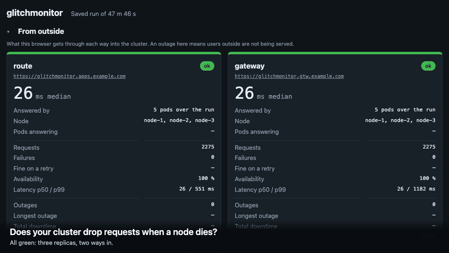
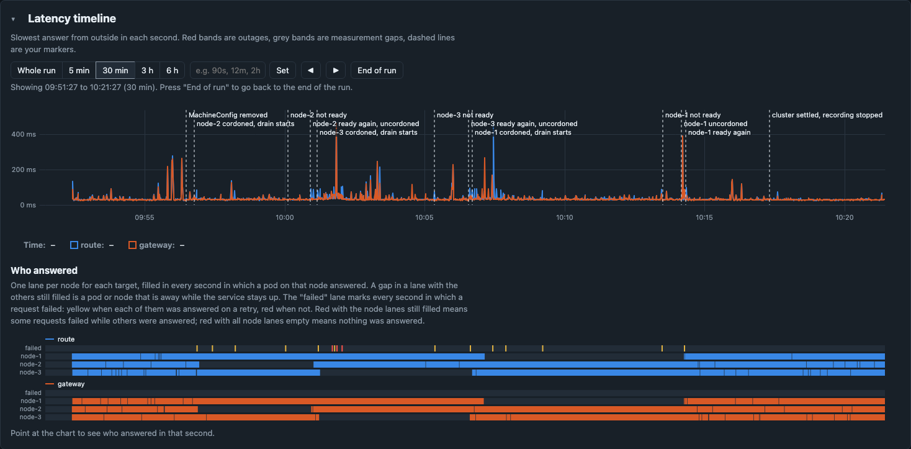
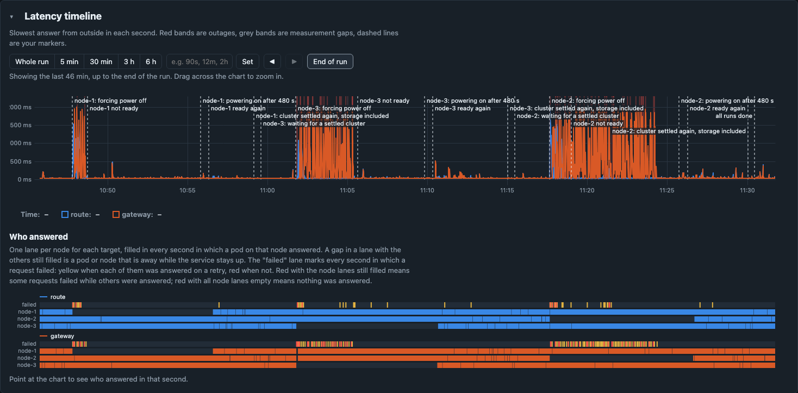
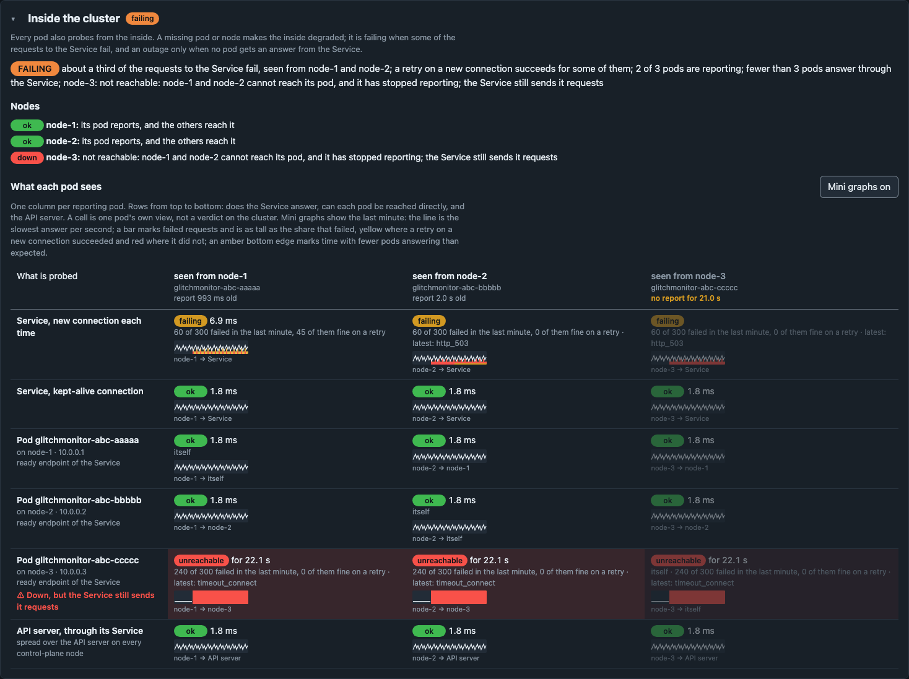

# glitchmonitor

**Does your cluster drop requests when a node dies, or when you patch it? Stop guessing. Watch it happen, and count every request that was lost.**

glitchmonitor is a small app you deploy to an OpenShift cluster and open in a browser. From that moment the page fires ten requests a second at the cluster through every way in, and every pod probes its neighbours from the inside. Then you put the cluster through what it is supposed to survive: restart the app, drain a node, roll out a MachineConfig, pull the power on a server. The dashboard shows, live and to the tenth of a second, what your users would have seen.

[](#try-it-without-a-cluster)

*A real recording, opened again in the dashboard. Click the picture to try it yourself.*

## Why you want this

"We run three replicas, so we are highly available" is a belief. This turns it into a measurement:

- **See it live.** Green, amber or red per way in, with a running outage timer, a flash and a beep.
- **Count it.** Requests, failures, outages, longest outage, total downtime and availability, for as long as the page is open.
- **Understand it.** A timeline with your own markers, a lane per node showing who answered, and what every pod saw from the inside at the same moment.
- **Keep it.** Export the run and open it again later, timeline included, to show someone who was not there.
- **Change something and measure again.** That is where it pays: a setting is no longer "should help" but "took the outage from twelve minutes to 75 seconds".

It needs no Prometheus, no load-testing rig and no service mesh: one page left open during the test.

## What it is

- **One Go binary** that serves the dashboard and answers `/api/ping`. It runs as three replicas, one per node, and is itself the thing being probed.
- **The browser is the outside probe.** It requests `/api/ping` through each address you configure, typically an OpenShift Route and a Gateway API HTTPRoute. All timers and counters live in the page.
- **Every pod is an inside probe.** Five times a second each pod asks the Service, every other pod directly, and the API server, and it watches which pods the Service currently sends traffic to.
- **Nothing to install beside it:** no database, no metrics stack, no CDN. It works on a disconnected cluster.

## What it showed us

The recordings are from a three-node OpenShift 4.22 lab cluster, where control plane and workers share the nodes, running glitchmonitor 0.7.1. The lab is virtualised and sits behind a TCP proxy, so the absolute numbers will differ on real hardware; the patterns should not. "Recorder" is a script that opens a new connection for every request; "browser" is the dashboard, which keeps its connections open.

### A rolling update: every node drained and rebooted



*Every node drained and rebooted, one after the other, in 18 minutes. Each node's lane goes empty while it is away; two lanes are filled at every moment.*

| | Route | Gateway |
|---|---|---|
| Recorder, new connection per request | 0 of 6,172 failed | 5 of 6,163 failed |
| Browser, long-lived connections | 19 of 26,420 failed | 0 of 26,420 failed |
| Outages | none | none |

The two kinds of client lose requests in opposite places. The browser lost single requests on the route at the moments the router reloaded its configuration; 16 of the 19 were answered on a retry. The recorder lost single requests on the gateway when a new connection landed on a proxy that was being moved. Inside the cluster, two requests failed in the whole run.

### A node dies: three hard power-offs

Each node was forced off for eight minutes, then powered on again.



| Node lost | It was running | Route: failed requests | Gateway: failed requests | Gateway trouble lasted |
|---|---|---|---|---|
| node-1 | nothing of the ingress path | 8 of 3,419 | 18 of 3,319 | 49 s |
| node-3 | a gateway proxy, the gateway's address | 10 of 3,896 | 411 of 3,448 | 5 min 15 s |
| node-2 | the gateway's control pod, a proxy | 11 of 3,733 | 170 of 2,491 | 6 min 42 s |

Which node you lose matters more than you would expect, and the recording says why:

- **The cluster can be slow to notice.** It took between one and four minutes to mark a node as lost. Until then nothing on it is taken out of rotation, and inside the cluster a third of new connections were sent to a pod that no longer existed.
- **Single copies hurt.** The gateway's control pod was a single copy. With it gone, the gateway kept using a dead pod until the control pod was replaced five minutes later.
- **Self-checking helps.** The route checks its backends itself and stopped using a dead pod within seconds, every time.

An earlier run on the same cluster was worse: losing one node made the gateway unreachable for twelve minutes, because both of its proxy pods sat on that node and their replacements found no CPU left to reserve. After spreading the proxies and freeing CPU, losing the same node cost about 75 seconds.

These are properties of how that cluster was set up, not verdicts on the products. Yours will differ, which is the point of measuring it.

### Inside the cluster



*Illustration with simulated reports: node-3 has just lost power.* One verdict for the inside, taken over all pods together (degraded, failing or outage), a line per node, and what each pod sees. This is the view that tells "the pod is down" apart from "the pod is fine but out of rotation" and from the dangerous one, "the pod is gone and the Service has not noticed".

## Try it without a cluster

<!-- Quick try, once the demo site is published (see .github/workflows/demo.yaml); remove this comment's markers then:
**In your browser, nothing to install:** [open the node power-off recording](https://jborup.github.io/glitchmonitor/) on the hosted demo. Drag across the chart to pick a stretch of time.
-->

The two recordings above are built into the app, with the node names replaced. Build it, start it, and open them:

```sh
make build
./bin/glitchmonitor serve
```

- Three nodes powered off: http://localhost:8080/?saved=demo/node-power-off.json
- A rolling update of every node: http://localhost:8080/?saved=demo/rolling-update.json

Drag across the chart to pick a stretch of time; the markers say when each machine was powered off, marked lost and powered on. The files are in [docs/demo/](docs/demo/), and `http://localhost:8080/?saved` opens any export of your own.

`http://localhost:8080/` gives a live dashboard that probes the local process: stop and start it to see an outage being recorded.

## Use it on your cluster

1. **[Deploy it](docs/deploy.md):** build the image, set your domain, and apply with kustomize, Helm or Argo CD. It needs three schedulable nodes and the default router, a Gateway, or both.
2. **[Run a test](docs/running-a-test.md):** a six-step script from an idle baseline to a hard node failure, with what to expect at each step.
3. **[Read the failures](docs/failed-requests.md):** which failed requests are safe to retry and which are not, and what one retry rescues.
4. **[Tune it](docs/tuning.md):** the settings worth knowing, and the three things outside the app that decide most of what you will measure.

## What it does not do

- **No authentication.** It is a demo and measurement tool; keep it on an internal network.
- **Nothing is stored on the server.** The numbers live in the browser tab, with a copy in that browser's storage. Export the JSON to keep a run.
- **The timeline keeps six hours.** Counters and the log keep going beyond that.
- **A browser is not every client.** It keeps connections open and cannot see why a connection failed. A headless probe mode that runs the same checks from a laptop or a VM is planned.

## Licence

AGPL-3.0-or-later; see [LICENSE](LICENSE). Commercial licences are available from the Stewards; see [COMMERCIAL-LICENSING.md](COMMERCIAL-LICENSING.md). Contributions are made under the Contributor License Agreement in [CLA.md](CLA.md); see [CONTRIBUTING.md](CONTRIBUTING.md). The licence documents are a draft. Third-party components and their licences are listed in [THIRD-PARTY-NOTICES.md](THIRD-PARTY-NOTICES.md).

`CLAUDE.md` is the project brief: the decisions taken and why.
